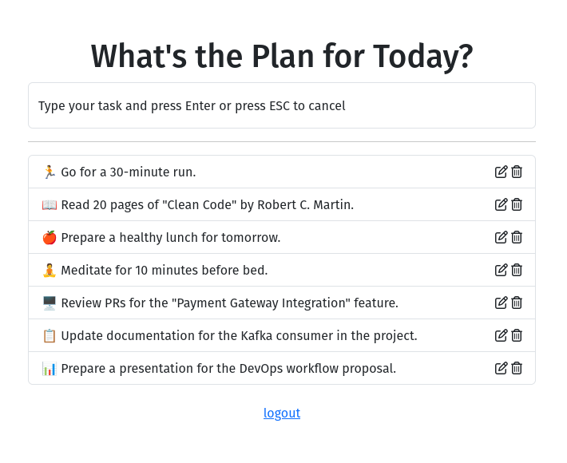

[](https://app.codacy.com/gh/ozaitsev92/go-react-todo-list/dashboard?utm_source=gh&utm_medium=referral&utm_content=&utm_campaign=Badge_grade)


---

# Go React TODO App

Simple TODO app build with Go, React and MongoDB.



---

### Usage
Run `make start` to run the app. The app is available at http://localhost:8081.
`make start` generates a gitignored `.env` with a random JWT signing key and MongoDB credentials on first run (delete it to rotate), then starts the stack with `docker compose`.

---

## Backend

Go 1.26, [Gin](https://gin-gonic.com/), MongoDB. The source is in [`backend/`](backend).

### Running

```bash
cd backend
make run                # in-memory storage, dev-only key, http://localhost:8080
make test               # unit tests, no Docker needed
make test-integration   # + MongoDB integration tests (Docker, or set MONGO_TEST_URI)
make lint vuln          # go vet + golangci-lint, govulncheck
```

### Configuration

Values come from built-in defaults, then an optional TOML file (`CONFIG_PATH`, default `./config/config.toml`; see [`config.example.toml`](backend/config/config.example.toml)), then environment variables, which win. Invalid configuration stops the process at startup.

| Env var | Default | Notes |
|---|---|---|
| `JWT_SIGNING_KEY` | (none, **required**) | ≥ 32 bytes, e.g. `openssl rand -hex 32`. Never commit it. |
| `STORAGE` | `mongo` | `memory` keeps data in-process only (lost on restart) |
| `MONGO_URL` / `MONGO_DB_NAME` | `mongodb://localhost:27017` / `todo` | |
| `BIND_ADDR` | `8080` | port |
| `ALLOWED_ORIGIN` | `http://localhost:8081` | the single origin allowed by CORS |
| `JWT_SESSION_LENGTH` | `30` | minutes |
| `JWT_SECURE_COOKIE` | `true` | set `false` only for plain-HTTP development |
| `JWT_COOKIE_DOMAIN`, `JWT_ISSUER` | `""`, `todo-api` | |
| `PASSWORD_HASH_COST` | `12` | bcrypt cost, 10–16 |
| `LOG_LEVEL` | `info` | `debug`, `info`, `warn`, `error` (JSON logs via `log/slog`) |
| `MAX_BODY_BYTES` | `65536` | larger requests get `413` |
| `MONGO_TIMEOUT`, `READ_HEADER_TIMEOUT`, `READ_TIMEOUT`, `WRITE_TIMEOUT`, `IDLE_TIMEOUT`, `GRACEFUL_TIMEOUT` | `10`, `5`, `15`, `15`, `60`, `15` | seconds |

### API

Authentication uses an `HttpOnly`, `SameSite=Lax` cookie named `jwt-token`, set by `POST /v1/users/login`. Errors always have the shape `{"error": "message"}`.

| Method & path | Success | Errors |
|---|---|---|
| `POST /v1/users` `{"email","password"}` | `201` user | `400` bad JSON, `409` email taken, `422` invalid email / password not 8–72 bytes |
| `POST /v1/users/login` `{"email","password"}` | `200` user + cookie | `401` invalid email or password |
| `POST /v1/users/logout` | `204`, cookie cleared | |
| `GET /v1/users/current` | `200` user | `401` |
| `GET /v1/tasks` | `200` own tasks, oldest first | `401` |
| `POST /v1/tasks` `{"text"}` | `201` task + `Location` | `400`, `413`, `422` text not 1–1000 chars |
| `GET /v1/tasks/{id}` | `200` task | `400` invalid id, `404` |
| `PUT /v1/tasks/{id}` `{"text"}` | `200` task | `400`, `404`, `422` |
| `PUT /v1/tasks/{id}/mark-completed`, `/mark-not-completed` | `200` task | `400`, `404` |
| `DELETE /v1/tasks/{id}` | `204` | `400`, `404` |
| `GET /healthz` / `GET /readyz` / `GET /metrics` | liveness / readiness (pings MongoDB) / Prometheus | `503` from `/readyz` when the DB is unreachable |

Another user's task returns the same `404` as a missing one, so the API never reveals that a task exists.

### Architecture

```
cmd/app ─▶ internal/app (composition root: config, storage, wiring, lifecycle)
              │
              ├─▶ internal/controller/http/v1   Gin handlers, DTOs, JWT cookie, middleware
              │        │
              ├─▶ internal/usecase              ownership checks, registration, authentication
              │        │                        (PasswordHasher port)
              │        ▼
              │   internal/domain/{task,user}   entities, invariants, repository ports
              │        ▲
              └─▶ internal/infrastructure       mongo + memory repositories, bcrypt hasher
pkg/{httpserver,logger,mongodb}                 generic helpers with no app imports
```

Dependencies point inward: `domain` imports nothing from the other layers. Both repository implementations pass one shared contract suite (`internal/infrastructure/repository/contract`), so they are interchangeable (`STORAGE=memory|mongo`).

### Design decisions and trade-offs

- **Stateless JWT in an HttpOnly cookie.** JavaScript can't read the token, so XSS can't steal it. CSRF is mitigated by `SameSite=Lax`, JSON-only mutations and a single-origin CORS policy. Tokens can't be revoked before they expire: logout clears the cookie, but a copied token stays valid for the rest of the session (30 min by default). Refresh tokens or a `jti` denylist would fix that; both are left out for simplicity.
- **Uniqueness comes from the database.** Emails are normalized (trimmed, lowercased; display-name forms like `Alice <a@x>` are rejected), and a unique MongoDB index created at startup enforces one account per email, even under concurrent sign-ups.
- **Login is timing-safe.** Unknown emails still run one bcrypt comparison, and every credential failure returns the same `401`.
- **Lifecycle.** Startup pings MongoDB with a timeout and creates indexes before serving. On SIGTERM the server drains HTTP and then disconnects MongoDB.
- **Not implemented yet:** rate limiting on the auth endpoints, pagination on `GET /v1/tasks`, and an OpenAPI spec.

### Kubernetes

The manifests in [`k8s/`](k8s) expect two Secrets that are not committed:

```bash
kubectl -n todo-app create secret generic mongo-secrets \
  --from-literal=username=todo --from-literal=password="$(openssl rand -hex 24)"
kubectl -n todo-app create secret generic backend-secrets \
  --from-literal=jwt-signing-key="$(openssl rand -hex 32)" \
  --from-literal=mongo-url="mongodb://todo:<password>@mongo-0.mongo:27017/?authSource=admin"
```

The ingress serves the API under `/api` (`/api/v1/tasks` → `/v1/tasks`).
